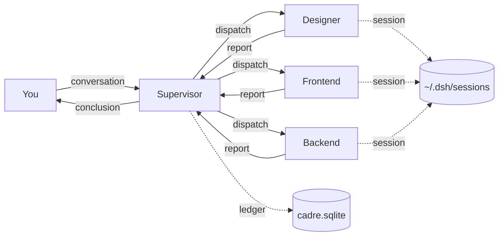

<p align="right"><strong>English</strong> · <a href="README.md">简体中文</a></p>

<p align="center">
  
</p>

<h1 align="center">Cadre Heihei</h1>

<h3 align="center">One AI writes it. The same AI calls it done.<br>Cadre Heihei separates the builder from the reviewer.</h3>

<p align="center">What reaches you is a conclusion with evidence.</p>

<p align="center">
  
  &nbsp;
  
  &nbsp;
  
</p>

<p align="center">
  <a href="https://github.com/KyuuKyuuStone/cadre-heihei/releases"></a>
</p>

A desktop AI collaboration client for Windows. You describe what you want to a supervisor agent; it splits the work, dispatches it to employee agents, collects their reports, reviews the results, and hands you the conclusion.

<p align="center">
  
</p>
<p align="center"><sub>The supervisor reports verified work, open items, and risks separately. Every line traces back to a deliverable.</sub></p>

## How it differs from a single chat

### The builder and the reviewer are not the same agent

A single AI writes the code and declares it finished. No second pair of eyes. When it says "done", you can only take its word for it.

Here an employee delivers, and the supervisor checks the work against the completion criteria, then reports verified items, open items, and risks separately. Both the verdict and the deliverables sit in the same project, so you can go back and look later.

### One role, one model

A single conversation runs everything through the same model — its strengths get diluted, its weaknesses amplified, and cost can't be tuned per task. Here every crew member is its own session and can run on a different model:

- **Architect** — long context, planning
- **Backend** — strong coding, tool use
- **Designer** — aesthetics and frontend
- **Docs / research** — cheap and fast

Several models working inside the same project at the same time, each doing what it does best. To swap the model on one role, change it inside that employee's session — nothing else moves, not the other roles, not the workflow.

Cost follows the work: strong models where it matters, cheap ones where it doesn't.

### Context is isolated per role

A single AI runs on one shared window. As the project grows, earlier agreements fall out of context, you fix one area and break another, and you end up pasting A's conclusion into B's chat.

Here every employee has its own session. The designer carries design context, the backend carries backend context. Neither window fills up with things it does not need.

### Parallel, not queued

A single AI does one thing at a time. The backend waits for the frontend to finish.

Here multiple employees run at once. You stop switching between windows.

## A real run

One request, from creating a project to delivery and review, in a single continuous session.

<p align="center">
  
</p>

### 01 A project is just a folder

<p align="center">
  
</p>

Point at a local folder. You get a separate team and a separate task ledger.

### 02 Say the idea

<p align="center">
  
</p>

One sentence is enough. No spec document required.

### 03 Break it down, dispatch it

<p align="center">
  
</p>

The supervisor splits the work, sets deadlines, and assigns by role.

### 04 Employees report back

<p align="center">
  
</p>

They come back with deliverables, not with "done".

## When not to use it

Fixing a script, writing a regex, looking up an API — a single AI gets there faster. Skip this.

It earns its keep when a project runs past a week, spans frontend and backend, or reaches the point where changing one thing breaks two others.

## Install

### From the installer (end users)

Download the Windows installer from [GitHub Releases](https://github.com/KyuuKyuuStone/cadre-heihei/releases). It is about 274 MB.

The installer is not code-signed, so SmartScreen may warn you. Choose "More info → Run anyway".

If the installer fails with `Windows error: 5`, your security software is usually scanning the unsigned files. Disable real-time protection temporarily, or whitelist `%LOCALAPPDATA%\Programs`, then retry.

### From source (developers)

You need Node.js and pnpm. Run these inside `desktop/`:

```bash
pnpm install
pnpm build          # compile lib
pnpm dev:desktop    # run in development mode
pnpm package:desktop:win:x64:unsigned  # build the Windows package
```

The full release flow lives in `desktop/apps/desktop/scripts/release.mjs`. For everything else, `desktop/package.json`'s `scripts` section is the source of truth.

## Architecture

The supervisor is the only entry point. Employees never talk to each other; all work flows through the supervisor.



- **Communication**: you talk to the supervisor only. It dispatches to employees, they report back, it reviews.
- **Context**: each employee is a separate session with its own context window.
- **Ledger**: roster, task state, and events live in SQLite. It is the source of truth for task status.
- **Data location**: `~/.dsh/cadre.sqlite` (ledger), `~/.dsh/sessions/` (JSONL conversations). All local.

## Repository layout

```
desktop/
├── apps/           # runnable targets: desktop (Electron client), desktop-host, cli, web
├── packages/       # feature packages: cadre (engine / host-collab), client, api, attachment, ...
├── cadre-collab/   # collaboration layer: protocol, ledger, dispatch, review
├── scripts/        # build, packaging, installer generation
└── UPSTREAM.md     # per-change log of modifications to upstream DeepSeek Harness
```

`desktop/` is a monorepo that contains both the upstream code and this project's collaboration layer.

## Customization and extension

### Add an employee role

An employee is a role prompt plus its own session. Adding one means:

1. Create an employee in the project, give it a name and a responsibility
2. The supervisor picks employees by responsibility when dispatching

Role templates for software work (frontend, backend, testing, code review) and general-purpose templates ship with the repo. Use them as-is or edit them.

Deeper extension points (new tools, new event types, connecting other model providers) live under `desktop/packages/cadre/`.

## Roadmap

**Works today**

- Supervisor dispatch, follow-up, and review, with verified / open / risk breakdowns
- Multiple employees in parallel, each with its own session
- Project isolation: one folder, one team
- Ledger tracking task state and events
- Fully local data; reinstalling keeps everything

**Next**

Undecided. Current issues and labels are the primary source for direction.

**Out of scope**

- No accounts, no cloud storage
- No web client (the upstream web shell is not maintained here)
- No platforms other than Windows

## Contributing

- **Issues**: bugs, rough edges, and feature requests are all welcome. Include reproduction steps and the version number.
- **Pull requests**: open an issue first so we can agree on scope. Make sure `pnpm run typecheck` and `pnpm run lint` pass.
- **Changing upstream code**: log it in `desktop/UPSTREAM.md` — where, why, and whether you plan to send it upstream.
- **Code standards**: see the gate scripts under `desktop/scripts/gates/` (file size, import boundaries, type baseline).

## FAQ

**Where is my data?**
The ledger is at `~/.dsh/cadre.sqlite`; conversations are under `~/.dsh/sessions/`. Everything is local.

**Does it need internet?**
Yes, for model inference through your configured provider. Your data is not uploaded.

**Which model providers are supported?**
Add your API key in Settings. The provider list in the app is authoritative.

**Does uninstalling delete my data?**
No. The ledger and sessions live in `~/.dsh`, which the uninstaller does not touch.

**Can I use it in a commercial project?**
Yes. This project is MIT. `LICENSE` retains the original DeepSeek copyright notice.

## Acknowledgements and license

Built on [DeepSeek Harness](https://github.com/deepseek-ai/deepseek-harness) (MIT). Thanks to the DeepSeek team for open-sourcing that foundation. The upstream LICENSE and THIRD_PARTY_NOTICES are preserved unchanged under `desktop/`.

This project is MIT — see [`LICENSE`](LICENSE). Changes made to upstream code are logged in [`desktop/UPSTREAM.md`](desktop/UPSTREAM.md).

Predecessor: [cc-heihei](https://github.com/KyuuKyuuStone/claude-code-heihei), frozen at v1.7.9.
