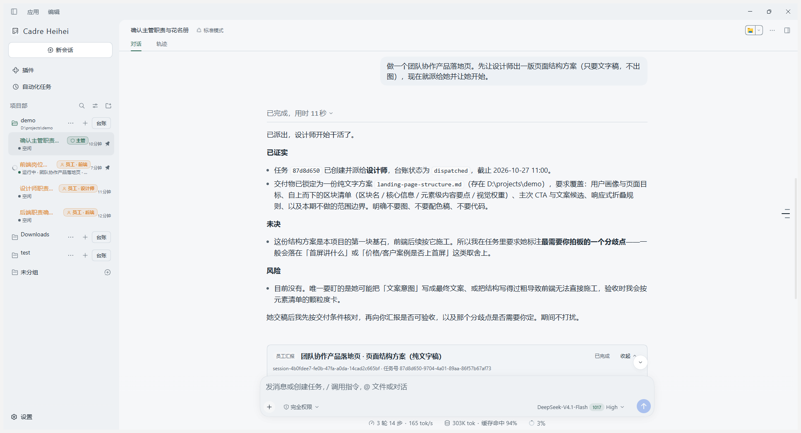
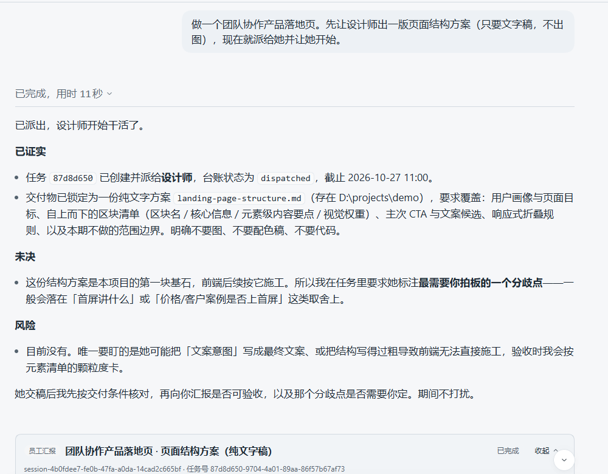
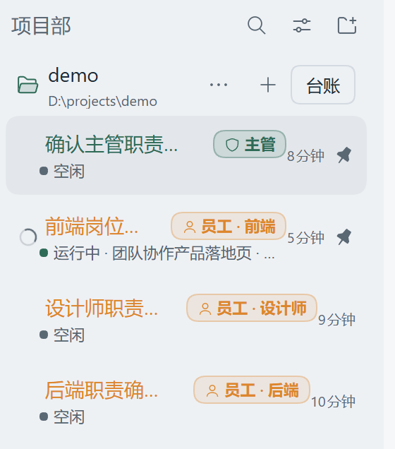

<strong>简体中文</strong> · <a href="README.en.md">English</a>

  

<h1 align="center">Cadre Heihei</h1>

如臂使指，一念百行——你跟主管说想法，它拆解、派活、验收，你只做决定。

  
  &nbsp;
  
  &nbsp;
  

  <a href="#它怎么工作">工作方式</a> ·
  <a href="#特色功能">特色功能</a> ·
  <a href="#截图">截图</a> ·
  <a href="#下载安装">下载安装</a> ·
  <a href="#快速开始">快速开始</a>

---

  

主界面：左侧是项目部与团队；右侧是主管在拆解需求、派活，并接收员工汇报。

## 它怎么工作

你不需要写需求文档，也不需要配置流程。整件事只发生在一条对话里。

| 步骤 | 谁 | 发生什么 |
|:---|:---|:---|
| 1 | 你 | 说出想要什么，随时改主意 |
| 2 | 主管 | 理解目标，拆成可执行任务，按员工职责派活 |
| 3 | 员工 → 主管 | 员工执行并交付；主管对照交付物验收，再向你汇报 |

每个项目部只有一名主管，是你唯一的对话对象。员工之间不互相说话，所有任务流向主管。

## 特色功能

<table>
<tr>
<td width="50%" valign="top"><strong>对话即调度</strong> 没有表单、看板或配置向导。说想法、改主意、催进度，都在同一条对话里完成。</td>
<td width="50%" valign="top"><strong>项目部即隔离边界</strong> 一个本地文件夹就是一个项目部。不同项目部的人员、任务与上下文互相看不见。</td>
</tr>
<tr>
<td valign="top"><strong>角色化员工</strong> 主管只调度不代劳；员工只执行不猜意图。一个员工就是一个独立会话，同一时间只压一件事。</td>
<td valign="top"><strong>台账与两层汇报</strong> 花名册、任务状态与交接都落在本地 SQLite。员工先向主管汇报，主管验收后再把「已证实 / 未决 / 风险」报给你。</td>
</tr>
</table>

## 截图

  

主管对话：一句需求 → 拆解派活 → 员工汇报卡。图中是真实运行记录。

  

侧栏团队：主管置顶；每名员工显示岗位、状态与当前任务。

## 下载安装

**下载**：[GitHub Releases v0.8.7](https://github.com/KyuuKyuuStone/cadre-heihei/releases/tag/v0.8.7) —— Windows 安装包（约 274 MB，未签名）

  

Windows 安装器：安装位置页，印章、字标与主按钮同屏。

- **系统**：Windows 10 / 11（仅桌面端）
- **签名**：安装包未做代码签名，SmartScreen 可能提示；选择「更多信息 → 仍要运行」
- **账户**：无需注册或登录。模型接入在「设置」里填你自己的 API Key
- **数据**：全部留在本机 `~/.dsh`；卸载不会删除数据，重装不丢团队与历史
- **自动更新与遥测**：默认关闭

## 快速开始

1. 安装并启动，在「设置」里填入模型服务商的 API Key。
2. 新建项目部（选一个本地文件夹），先建一名主管，再按需建员工（可直接套用角色模板）。
3. 打开主管会话，说清你想做什么。拆解、派活、催进度、验收，它自己会走。

技术栈、致谢与许可

- **平台**：Windows 桌面端（Electron）；上游的 Web 外壳不在本项目的维护范围内
- **内核**：[DeepSeek Harness](https://github.com/deepseek-ai/deepseek-harness)（MIT），插件化架构
- **存储**：任务台账 SQLite（`~/.dsh/cadre.sqlite`），会话 JSONL，全部在本机
- **上游改动**：逐条记录在 [`desktop/UPSTREAM.md`](desktop/UPSTREAM.md)
- **许可**：本项目 MIT；[`LICENSE`](LICENSE) 保留上游 DeepSeek 的原始版权声明
- **前身**：[cc-heihei](https://github.com/KyuuKyuuStone/claude-code-heihei)，冻结于 v1.7.9

感谢 DeepSeek 团队开源 DeepSeek Harness——没有这套底座，这个项目不会是今天的样子。

