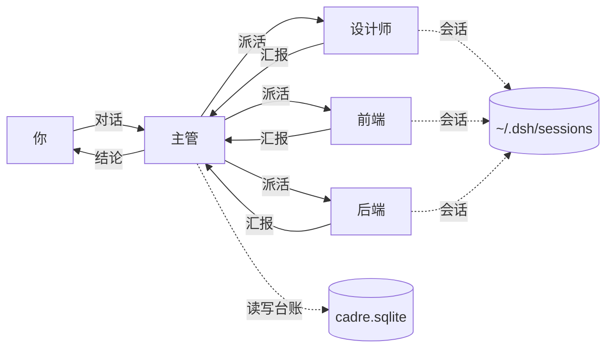

<p align="right"><strong>简体中文</strong> · <a href="README.en.md">English</a></p>

<p align="center">
  
</p>

<h1 align="center">Cadre Heihei</h1>

<h3 align="center">单一 AI 自己写，自己说「完成了」。<br>Cadre Heihei 让写的人和验收的人分开。</h3>

<p align="center">你收到的，是带证据的结论。</p>

<p align="center">
  
  &nbsp;
  
  &nbsp;
  
</p>

<p align="center">
  <a href="https://github.com/KyuuKyuuStone/cadre-heihei/releases"></a>
</p>

Windows 桌面端的 AI 协作客户端。你把想法说给「主管」，它拆成任务，派给「员工」执行；员工回报，主管验收，再把结论给你。

<p align="center">
  
</p>
<p align="center"><sub>主管把「已证实 / 未决 / 风险」分开报。每一句都能追到交付物。</sub></p>

## 它和单一对话的区别

### 写的和验收的不是同一个

单一 AI 写完自己说好了，没有第二双眼睛。它说「已完成」，你只能信。

这里员工交付，主管对照完成条件逐条验收，把已验证、未决、风险分开报给你。验收结论和交付物挂在同一个项目部里，事后能翻。

### 上下文按角色隔离

单一 AI 的窗口是共享的。项目一大，早期定好的约定被挤出窗口，改东边崩西边，你还得把 A 的结论复制给 B。

这里每个员工是独立会话。设计师只装设计相关内容，后端只装后端相关内容，各自窗口不被无关内容占满。

### 并行，不是排队

单一 AI 一次只能干一件事，等它改完前端才轮到后端。

这里多个员工同时跑。你不用在几个窗口之间来回切。

## 一次实机演示

同一份需求，从建项目部到交付验收，一次连续运行。

<p align="center">
  
</p>

### 01 建项目部，就是一个文件夹

<p align="center">
  
</p>

选一个本地文件夹，得到独立的团队和任务台账。

### 02 说想法

<p align="center">
  
</p>

一句话说清要什么，不用写需求文档。

### 03 拆解派活

<p align="center">
  
</p>

主管拆成任务，标明截止时间，按职责分派。

### 04 员工汇报

<p align="center">
  
</p>

带着交付物回来，不是只回一句「做完了」。

## 什么时候别用它

改个脚本、写个正则、查个 API 怎么用——一个 AI 更快，别开这个。

项目会长到一周以上、跨前后端，或者出现「改一处另外两处会崩」——那才是它的活。

## 安装

### 用安装包（普通用户）

从 [GitHub Releases](https://github.com/KyuuKyuuStone/cadre-heihei/releases) 下载 Windows 安装包，约 274 MB。

安装包未做代码签名，SmartScreen 可能提示。选择「更多信息 → 仍要运行」。

如果安装过程报 `Windows error: 5`，通常是安全软件正在扫描未签名的文件。先退出安全软件实时防护，或把 `%LOCALAPPDATA%\Programs` 加入白名单后重试。

### 从源码构建（开发者）

需要 Node.js 和 pnpm。在 `desktop/` 目录下操作：

```bash
pnpm install
pnpm build          # 编译 lib
pnpm dev:desktop    # 开发模式启动
pnpm package:desktop:win:x64:unsigned  # 打 Windows 包
```

完整的发布流程见 `desktop/apps/desktop/scripts/release.mjs`；其余脚本以 `desktop/package.json` 的 `scripts` 为准。

## 架构

主管是唯一的入口。员工之间不互相通信，所有任务流向主管。



- **通信**：你只和主管说话。主管把任务派给员工，员工完成后向主管汇报，主管验收。
- **上下文**：每个员工是独立会话，各自一份上下文，互不污染。
- **台账**：花名册、任务状态、事件记录存在 SQLite 里，是任务状态的唯一真相。
- **数据位置**：`~/.dsh/cadre.sqlite`（台账）；`~/.dsh/sessions/`（会话 JSONL）。全部在本机。

## 目录结构

```
desktop/
├── apps/           # 可运行程序：desktop（Electron 客户端）、desktop-host、cli、web
├── packages/       # 功能包：cadre（engine / host-collab）、client、api、attachment 等
├── cadre-collab/   # 协作层：协议、台账、派活与验收
├── scripts/        # 构建、打包、安装器生成
└── UPSTREAM.md     # 对上游 DeepSeek Harness 的改动逐条登记
```

`desktop/` 本身是一个 monorepo，同时包含上游代码和本项目的协作层。

## 自定义与扩展

### 加一个新的员工角色

员工就是一段角色提示词加上一个独立会话。加一个角色只需要：

1. 在项目部里新建员工，填名称与职责
2. 主管派活时会按职责选择员工

现有的软件类角色模板（前端、后端、测试、代码审查等）和通用模板都在仓库内，可以直接套用或改。

更深入的扩展点（新的工具、新的事件类型、接别的模型服务商）见 `desktop/packages/cadre/`。

## Roadmap

**现在能做的**

- 主管派活、催办、验收，结论带「已证实 / 未决 / 风险」分栏
- 多员工并行，各自独立会话
- 项目部隔离，一个文件夹一套团队
- 台账记录任务状态与事件
- 数据全在本地，重装不丢

**下一步**

待定。仓库当前的 issue 与标签是本项目路线的主要来源。

**不做**

- 不做账户体系，不做云端存储
- 不维护 Web 端（上游的 web 外壳不在本项目维护范围）
- 不做 Windows 以外的平台

## 贡献

- **提 issue**：bug、体验问题、想要的能力都可以提。附上复现步骤和版本号。
- **提 PR**：先开 issue 说明你要做什么，避免白做。改完后确保 `pnpm run typecheck` 和 `pnpm run lint` 通过。
- **改上游代码**：对 DeepSeek Harness 上游文件的改动要在 `desktop/UPSTREAM.md` 登记，写清位置、原因、是否计划合并回上游。
- **代码规范**：见 `desktop/scripts/gates/` 下的门禁脚本（文件大小、import 边界、类型基线）。

## FAQ

**数据存在哪？**
台账在 `~/.dsh/cadre.sqlite`，会话在 `~/.dsh/sessions/`。都在本机。

**要联网吗？**
要。模型推理走你配置的服务商 API。数据本身不上传。

**支持哪些模型服务商？**
在「设置」里填 API Key。具体支持列表以应用内的服务商选项为准。

**卸载会删数据吗？**
不会。台账和会话都在 `~/.dsh`，卸载不碰。

**能用在自己的商业项目里吗？**
可以。本项目 MIT。`LICENSE` 里保留了上游 DeepSeek 的原始版权声明。

## 致谢与许可

内核基于 [DeepSeek Harness](https://github.com/deepseek-ai/deepseek-harness)（MIT）构建，感谢 DeepSeek 团队开源这套底座。上游的 LICENSE 与 THIRD_PARTY_NOTICES 原样保留在 `desktop/` 下。

本项目 MIT，见 [`LICENSE`](LICENSE)。对上游的改动逐条记录在 [`desktop/UPSTREAM.md`](desktop/UPSTREAM.md)。

前身项目：[cc-heihei](https://github.com/KyuuKyuuStone/claude-code-heihei)，冻结于 v1.7.9。
