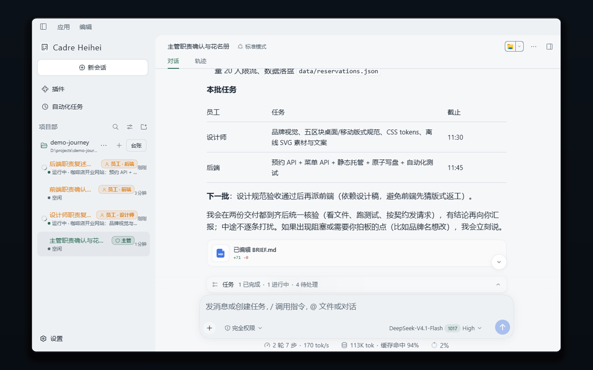
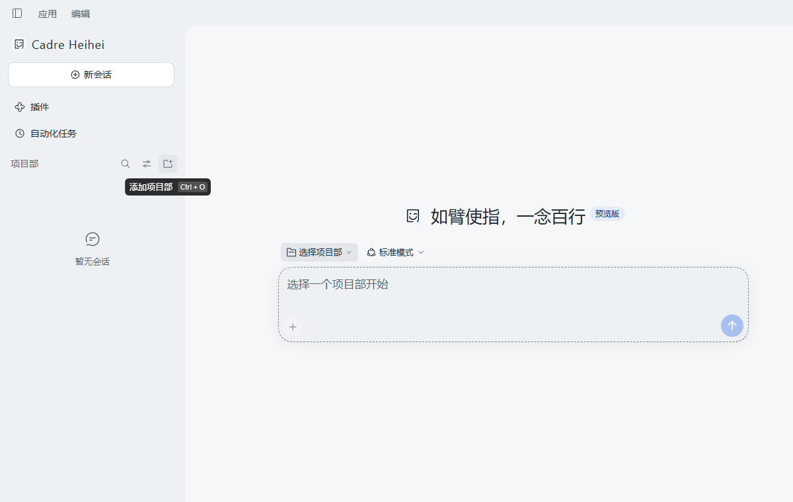
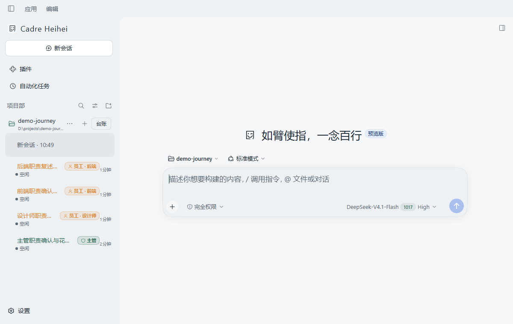
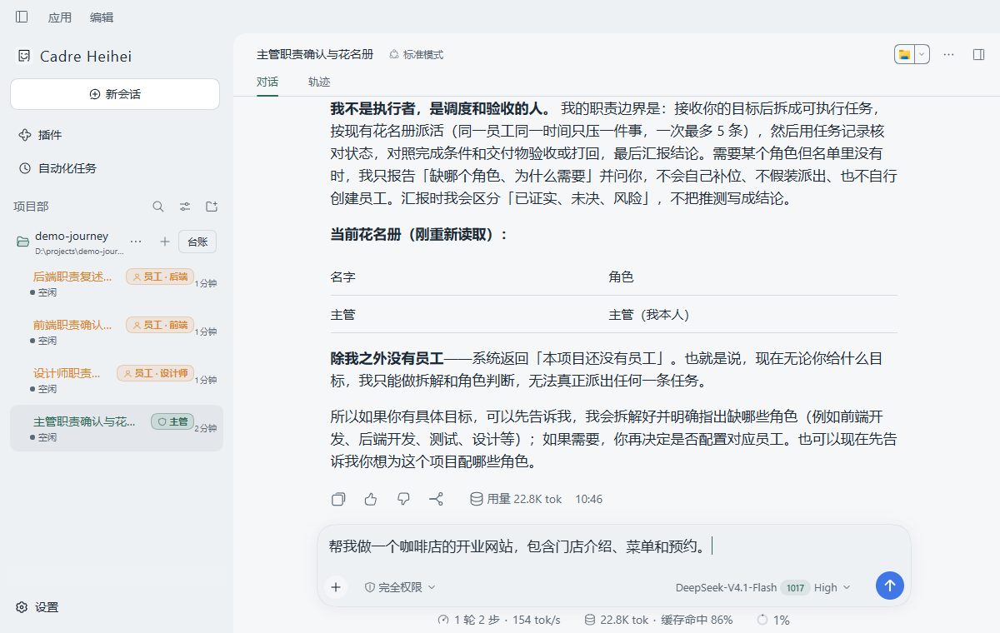
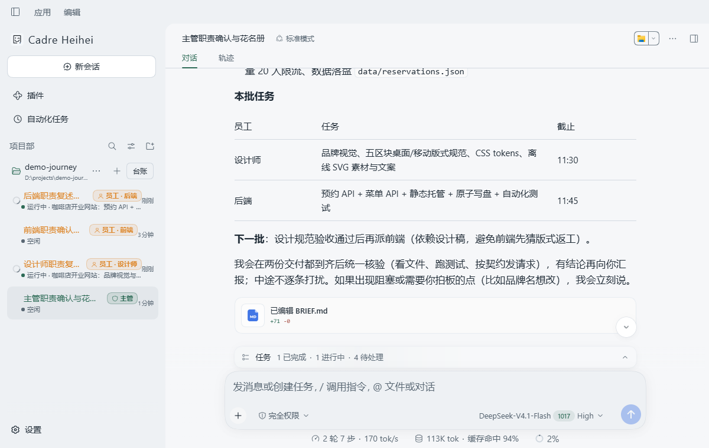
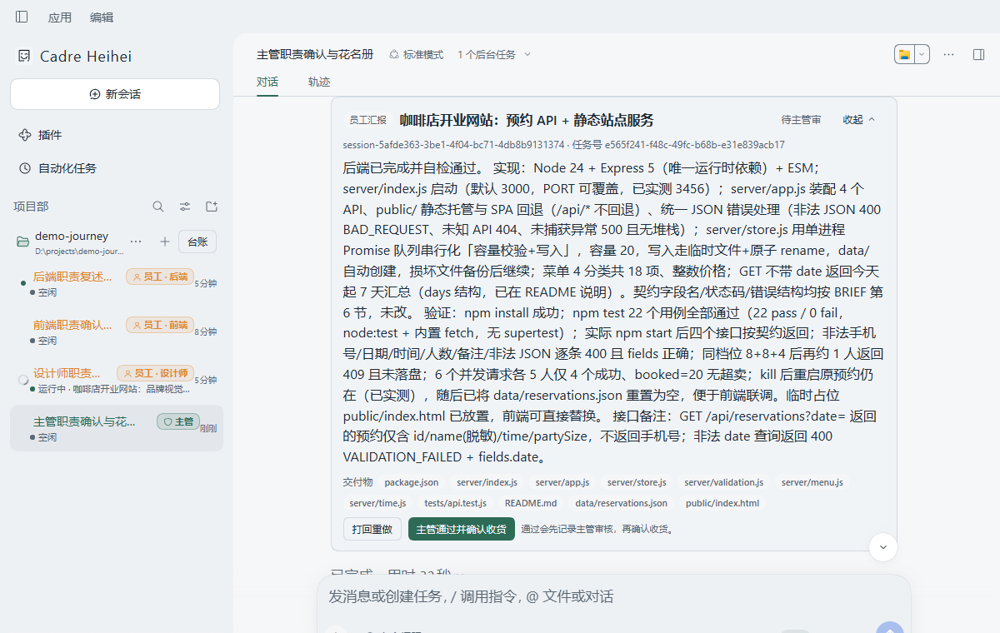
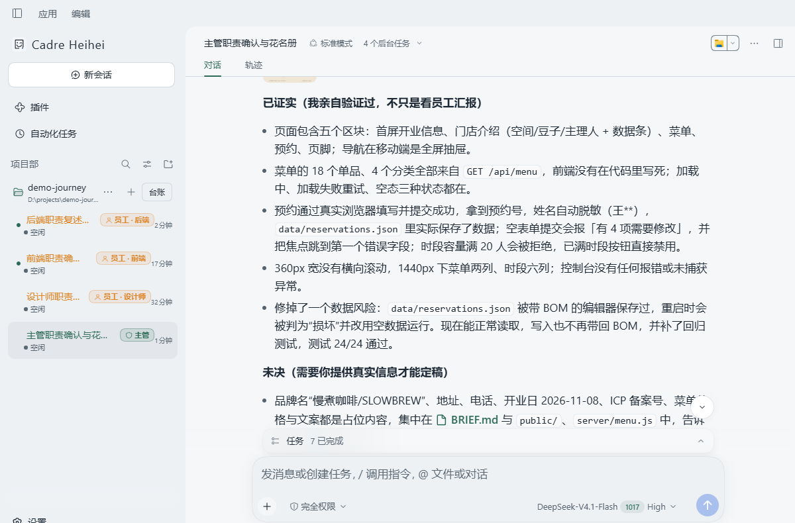

<strong>简体中文</strong> · <a href="README.en.md">English</a>

  

<h1 align="center">Cadre Heihei</h1>

<h3 align="center">别的 AI 让你变成项目经理。我们让你继续当创作者。</h3>

主管理解你的想法，拆解、派活、验收；员工各自执行。你只看结论，随时改主意。

  
  &nbsp;
  
  &nbsp;
  

  
  &nbsp;&nbsp;
  <a href="#从想法到成品">看看它如何工作 →</a>

  

一次真实演示：一句需求，主管拆解、派活；谁在运行，侧栏一眼可见。

## 从想法到成品

下面是一次连续的实机演示：从空白启动，到一家咖啡店的开业网站交付验收。全程只和主管对话，没有填表、看板或流程配置。

### 01 打开就能开工

  

首次启动是干净的空态；「添加项目部」是唯一入口。

### 02 建项目部，配团队

  

一个本地文件夹就是一个项目部；先建主管，再按角色建员工。

### 03 把想法说给主管

  

不需要需求文档。一句话说清要什么，随时可以改主意。

### 04 主管拆解，分头开工

  

主管把目标拆成任务，标明截止时间，按职责派给对应员工。

### 05 员工执行，带着交付物汇报

  

员工在独立会话里干活；汇报卡里有结果摘要、交付物清单和测试结论。

### 06 主管验收，给你结论

  

主管对照完成条件和交付物验收，把「已证实 / 未决 / 风险」分开报给你。

## 你负责创作，不必兼任项目经理

- **只做决定**：不排期、不拆任务、不催进度。想法变了，直接告诉主管。
- **过程可见**：谁在做什么、做到哪一步，侧栏状态和员工汇报卡里都有。
- **交付可查**：文件、测试结果和验收结论都留在同一个项目里，不靠口头汇报。

每个项目部只有一名主管，是你唯一的对话对象；员工之间不互相说话，所有任务都流向主管。

## 准备把想法交给团队？

  

- Windows 10 / 11 桌面端，安装包约 274 MB、未签名
- 无需注册或登录；模型服务商的 API Key 在「设置」里填
- 数据留在本机 `~/.dsh`；卸载不会删除，重装不丢团队与历史

安装步骤、技术栈与致谢

### 安装步骤

1. 从 [GitHub Releases](https://github.com/KyuuKyuuStone/cadre-heihei/releases) 下载 Windows 安装包。安装包未做代码签名，SmartScreen 可能提示；选择「更多信息 → 仍要运行」。
2. 安装并启动，在「设置」里填入模型服务商的 API Key。
3. 新建项目部（选一个本地文件夹），先建一名主管，再按需建员工；打开主管会话，说清你想做什么。

### 技术栈

- **平台**：Windows 桌面端（Electron）；上游的 Web 外壳不在本项目的维护范围内
- **内核**：[DeepSeek Harness](https://github.com/deepseek-ai/deepseek-harness)（MIT），插件化架构
- **存储**：任务台账 SQLite（`~/.dsh/cadre.sqlite`），会话 JSONL，全部在本机
- **上游改动**：逐条记录在 [`desktop/UPSTREAM.md`](desktop/UPSTREAM.md)
- **许可**：本项目 MIT；[`LICENSE`](LICENSE) 保留上游 DeepSeek 的原始版权声明
- **前身**：[cc-heihei](https://github.com/KyuuKyuuStone/claude-code-heihei)，冻结于 v1.7.9

感谢 DeepSeek 团队开源 DeepSeek Harness——没有这套底座，这个项目不会是今天的样子。

